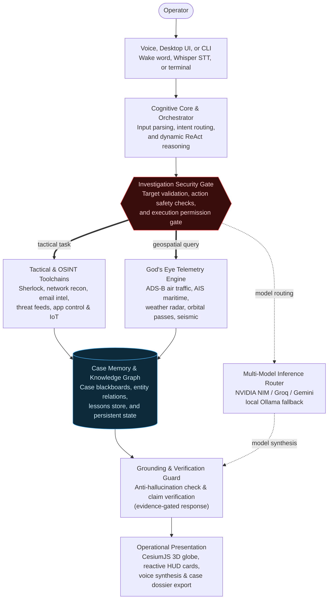
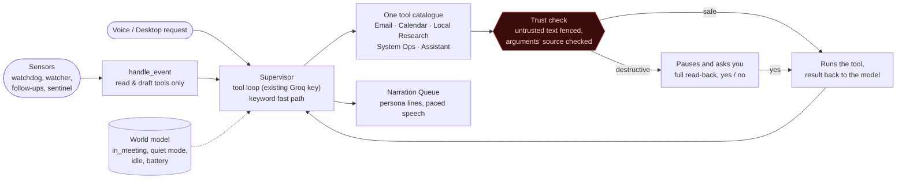

<p align="center">
  
</p>

<h1 align="center">J.A.R.V.I.S. : AUTONOMOUS TACTICAL OSINT SPECIALIST & INTELLIGENCE SYSTEM</h1>
<p align="center">
  <b>Just A Rather Very Intelligent System — Autonomous OSINT Specialist & Intelligence Framework by Project Hellhound</b>
  <br>
  <i>An authoritative, multi-source OSINT intelligence powerhouse and tactical assistant. Equipped with deep target enumeration, multi-platform username scans (300+ services), identity pivoting, email verification, domain/WHOIS mapping, historical archives, breach telemetry, real-time ADS-B military flight tracking, keyless atmospheric telemetry, and 2D/3D topology graphing. J.A.R.V.I.S. doesn't just collect data—he cross-correlates, verifies, and delivers actionable, grounded investigative intelligence.</i>
</p>

<p align="center">
  <a href="#quick-start">Quick Start</a> ·
  <a href="#installation--setup">Installation & Setup</a> ·
  <a href="#gods-eye-geointel--3d-satellite-reconnaissance">God's Eye Geointel</a> ·
  <a href="#settings-panel--free-api-configuration">Settings Panel</a> ·
  <a href="#the-osint-specialist-arsenal">OSINT Arsenal</a> ·
  <a href="#ai-model-routing">AI Routing</a> ·
  <a href="#commands">Commands</a> ·
  <a href="#voice-engine">Voice Engine</a> ·
  <a href="#desktop-gui-app">Desktop GUI</a> ·
  <a href="#autonomous-agents--account-integrations">Agents</a> ·
  <a href="#mobile-companion">Mobile Companion</a> ·
  <a href="#license">License</a>
</p>

<p align="center">
  <a href="https://www.python.org/"></a>
  <a href="https://github.com/projecthellhound/JARVIS/releases"></a>
  
  
  
  
  
  
</p>

---

> [!NOTE]
> ### 🛡️ Authoritative OSINT Specialist & Intelligence Protocol
> **J.A.R.V.I.S.** operates as an elite, autonomous **OSINT specialist and intelligence officer**. Drawing upon dozens of cross-referenced intelligence sources—from global domain infrastructure and social registries to real-time ADS-B airspace feeds and breach archives—he verifies and correlates findings before drawing conclusions. His analysis is delivered with **refined British eloquence, dry wit, unflappable composure, and absolute factual grounding**.

---

## What Is This?

**J.A.R.V.I.S.** is an autonomous tactical OSINT specialist and personal intelligence framework developed by **Project Hellhound**. Built from the ground up for cybersecurity researchers, bug bounty hunters, CTF competitors, and intelligence operators, J.A.R.V.I.S. consolidates every phase of open-source reconnaissance into an automated, interactive workflow.

### Why J.A.R.V.I.S. is an Authoritative OSINT Source
Unlike passive scrapers or noisy search wrappers, J.A.R.V.I.S. acts as a true intelligence analyst:
- **Multi-Vector Entity Pivoting**: Transition seamlessly from an email address to a username, discover associated GitHub repositories, parse commit histories for developer identities, extract PGP keys, and uncover domain infrastructure.
- **Strict Anti-Hallucination Grounding**: All verbal debriefs, monologues, and dossier exports are bound 100% to verified scan data recorded on the persistent blackboard. Zero fabricated usernames, zero invented endpoints.
- **Persistent Case Blackboard**: Every target investigation creates an isolated, auditable workspace (`cases/<target>/` and `data/jarvis_memory.json`) storing raw API outputs, normalized entity graphs, timestamped evidence notes, and exportable HTML dossiers.
- **Aerial & Infrastructure Telemetry**: Integrated real-time military flight tracking (ADS-B), atmospheric weather intelligence, and public surveillance capabilities inspired by *God's Eye View*.

Operate across three flexible interfaces:
- **Desktop GUI Application**: A dedicated PyWebView/FastAPI desktop interface featuring collapsible card modules, transparent eye API key toggles, 2D/3D radial topology graphs, and hands-free microphone input (`jarvis`).
- **Interactive Terminal**: An interactive terminal environment with real-time monologue streaming, live progress feedback, and inline command execution (`jarvis --cli`).
- **Headless CLI Runner**: Direct one-line command execution for automated scripts and headless task triggers (`jarvis investigate <target>`).

---

## How It Works



- **Investigation Security Gate**: Unscoped targets and unauthorized system actions are validated and permission-gated before execution.
- **Multi-Model Inference Router**: Dynamic dispatch between NVIDIA NIM, Groq LPU, Google Gemini, and local Ollama SLMs based on task complexity.
- **God's Eye Geointel Engine**: Real-time telemetry ingestion and geospatial tracking across ADS-B aircraft, AIS maritime vessels, weather radar, orbital passes, and seismic feeds.
- **Isolated Case Blackboards**: Target findings, entity relationship graphs, and harvested artifacts persist in dedicated case workspaces.
- **Grounding Verification Guard**: Anti-hallucination checks compare synthesized claims against verified evidence before narration or dossier export.

---

## The OSINT Specialist Arsenal

J.A.R.V.I.S. equips operators with a comprehensive multi-discipline reconnaissance arsenal:

| Category | Module | Engine / Method | Capabilities |
| :--- | :--- | :--- | :--- |
| **Identity & Accounts** | `sherlock` | HTTP/Async Probe | Account discovery across 300+ social and developer platforms. |
| | `maigret` | Deep Metadata Parse | Identity aggregation, profile harvesting, and cross-site verification. |
| | `holehe` | Mail Endpoint Check | Checks email registration across 120+ web services without notifying targets. |
| | `gravatar` | Hash Lookup | Public avatar, bio, display name, and verified profile extraction. |
| **Code & Developer** | `github_recon` | GitHub Public API | Repository inspection, commit email trails, and SSH/PGP key harvesting. |
| **Domain & Network** | `dns_whois` | Socket / RDAP / DNS | Pulls A, AAAA, MX, TXT, CNAME, NS records, and registrar ownership. |
| | `wayback` | CDX Archive Index | Historic URL enumeration, forgotten subdomains, and historical snapshots. |
| **Media & Geo** | `exif_geo` | PIL / EXIF Parser | Extracts GPS coordinates, altitude, camera model, and timestamp metadata. |
| **Threat & Reputation** | `abuse_ipdb` | Threat Intelligence | Evaluates IP threat scores, ISP classification, and proxy/VPN exit nodes. |
| | `breach_directory` | Credential Telemetry | Discovers compromised account breaches and exposed data field classes. |
| **Aerial & Telemetry** | `adsb_radar` | Keyless ADS-B | Real-time military flight tracking, altitude, callsigns, and squawk codes. |
| | `atmospheric_intel` | Open-Meteo | Keyless real-time weather telemetry, cloud cover, and barometric pressure. |
| | `thermal_sensors` | NASA FIRMS | Real-time active wildfire and thermal satellite sensor anomalies (VIIRS/MODIS). |
| | `satellite_geointel` | CesiumJS / Ion | High-resolution 3D World Terrain, 3D OSM buildings, and orbital tracking. |
| **Inference Acceleration** | `groq_lpu` | Groq LPU Engine | Sub-100ms ultra-low-latency LLaMA 3.3 70B and Whisper audio transcription. |
| **Visualization** | `2d_3d_topology` | D3 / Three.js | Radial SVG relationship fallback + 3D WebGL entity topology graph. |

---

## 🌍 God's Eye Geointel & 3D Satellite Reconnaissance

J.A.R.V.I.S. integrates the spatial intelligence architecture inspired by **God's Eye View**, delivering global situational awareness directly inside the spatial 3D WebGL viewport:

### Keyless Global Intelligence (Works 100% Out of the Box)
- **Airspace Radar (ADS-B)**: Real-time military and commercial aircraft tracking worldwide via `api.adsb.lol` / `airplanes.live`. Single-click any contact for callsign, altitude, ground speed, Mach velocity, squawk code, and heading.
- **Maritime Vessels (AIS)**: Worldwide commercial shipping and naval vessel locations with MMSI, vessel type, and heading indicators.
- **Global Radio Scanner Tuner**: 100% genuine live audio feeds from major international aviation towers (Tokyo Haneda ATC, Heathrow Tower ATC) and emergency dispatch channels (SF Police/Fire, BBC World Service).
- **USGS Planetary Seismic Monitor**: Real-time earthquake monitoring ($M \ge 4.5$) with fault zone radius visualization and hypocenter depth telemetry.
- **Orbital Satellite Tracking**: Live International Space Station (ISS) ephemeris tracking with nadir drop beam and 90-minute ground orbital track projection.
- **High-Resolution Satellite Imagery**: Keyless ESRI World Imagery with OpenStreetMap fallback and photorealistic vibrance calibration.

---

## ⚙️ Settings Panel & Free API Configuration

J.A.R.V.I.S. includes a dedicated **Settings Panel** (`⚙` button in the UI header or `/settings`) allowing operators to dynamically configure model endpoints, voice synthesis, and geointel providers without restarting the application:

```
┌─────────────────────────────────────────────────────────────┐
│                   J.A.R.V.I.S. — SETTINGS                   │
├─────────────────────────────────────────────────────────────┤
│ [LLM] Language Model Engine        [Ollama / Gemini / NIM]  │
│ [VOX] Fish Audio Voice Engine      [s2.1-pro-free / Vox ID] │
│ [GEO] God's Eye Geointel & Accel   [Cesium / NASA / Groq]   │
│ [RCN] Reconnaissance Modules       [Sherlock / Maigret...]  │
└─────────────────────────────────────────────────────────────┘
```

### Unlocking Extra Capabilities with Free API Keys

All keys are **optional**. J.A.R.V.I.S. functions completely offline and keyless, but these free provider keys unlock immense extra analytical power:

| Provider | Setting Field | Unlocked Capabilities | How to Get (100% Free) |
| :--- | :--- | :--- | :--- |
| **Cesium Ion** | `cesium_ion_token` | **High-Resolution 3D World Terrain**, 3D Photorealistic Tiles, and **3D OpenStreetMap Buildings**. | [ion.cesium.com/tokens](https://ion.cesium.com/tokens) |
| **NASA FIRMS** | `nasa_firms_key` | **Real-time satellite active wildfire & thermal anomaly sensors** (VIIRS NOAA-20, NOAA-21, Suomi-NPP). | [firms.modaps.eosdis.nasa.gov/api/map_key/](https://firms.modaps.eosdis.nasa.gov/api/map_key/) |
| **Groq LPU** | `groq_api_key` | **Sub-100ms ultra-fast inference** with `llama-3.3-70b-versatile` & Groq Whisper transcription (~800 tokens/sec). | [console.groq.com/keys](https://console.groq.com/keys) |
| **NVIDIA NIM** | `nvidia_api_key` | **Frontier 550B MoE reasoning** (`nvidia/nemotron-3-ultra-550b-a55b`). | [build.nvidia.com](https://build.nvidia.com) |
| **Google Gemini** | `gemini_api_key` | Multimodal vision analysis and deep entity correlation. | [aistudio.google.com/apikey](https://aistudio.google.com/apikey) |
| **Fish Audio** | `fish_audio_api_key` | Ultra-realistic British tactical voice synthesis (`05b36da8574341d0803391491850db20`). | [fish.audio/app/developers](https://fish.audio/app/developers) |
| **YouTube Data API** | `YOUTUBE_API_KEY` | **Geotagged field video intelligence & OSINT dispatches** within scan radius. | [console.cloud.google.com](https://console.cloud.google.com) |

### 🔑 Step-by-Step Guide to Acquiring Free API Keys

Operator keys can be configured instantly in the GUI via the **Settings Panel** (`⚙ SETTINGS` button in the top bar or via `/settings` in chat), or by editing `config.yaml` / `.env`:

#### 1. Cesium Ion Access Token (`cesium_ion_token`)
* **What it unlocks:** High-resolution 3D World Terrain elevation mesh, worldwide 3D photorealistic tiles, and 3D OpenStreetMap building models on the 3D globe.
* **Steps to obtain (100% Free):**
  1. Sign up for a free Community account at [ion.cesium.com/signup](https://ion.cesium.com/signup).
  2. Navigate to **Access Tokens** at [ion.cesium.com/tokens](https://ion.cesium.com/tokens).
  3. Copy your default token (or generate a new token with `assets:read` permission).
  4. In J.A.R.V.I.S., click **⚙ SETTINGS** (or type `/settings`), paste into **Cesium Ion Access Token**, and click **Save Settings**.

#### 2. NASA FIRMS MAP_KEY (`nasa_firms_key`)
* **What it unlocks:** Live near-real-time satellite thermal anomaly detections and active wildfire hotspots across the globe (VIIRS NOAA-20, NOAA-21, and MODIS sensors).
* **Steps to obtain (100% Free):**
  1. Visit the NASA FIRMS MAP KEY portal: [firms.modaps.eosdis.nasa.gov/api/map_key/](https://firms.modaps.eosdis.nasa.gov/api/map_key/).
  2. Enter your email address and click **Get MAP KEY**.
  3. NASA will immediately send your unique 32-character key to your inbox.
  4. Paste into the **NASA FIRMS MAP_KEY** field in Settings and click **Save Settings**.

#### 3. Groq LPU API Key (`groq_api_key`)
* **What it unlocks:** Sub-100ms ultra-low-latency reasoning with `llama-3.3-70b-versatile` and accelerated voice transcription via Groq Whisper (~800 tokens/sec).
* **Steps to obtain (100% Free):**
  1. Go to the Groq Cloud Console at [console.groq.com/keys](https://console.groq.com/keys).
  2. Sign in with GitHub or Google.
  3. Click **Create API Key**, enter a friendly name (e.g. `JARVIS`), and copy your key starting with `gsk_`.
  4. Paste into the **Groq LPU API Key** field in Settings and click **Save Settings**.

#### 4. NVIDIA NIM API Key (`nvidia_api_key`)
* **What it unlocks:** Frontier-class 550B MoE reasoning engine (`nvidia/nemotron-3-ultra-550b-a55b`).
* **Steps to obtain (100% Free):**
  1. Go to [build.nvidia.com](https://build.nvidia.com) and log in.
  2. Select `nvidia/nemotron-3-ultra-550b-a55b` or search for any Nemotron model.
  3. Click **Get API Key** and generate your key (`nvapi-...`). NVIDIA provides generous free tier credits.
  4. Paste into **NVIDIA NIM API Key** in Settings.

#### 5. Google Gemini API Key (`GEMINI_API_KEY` / `gemini_api_key`)
* **What it unlocks:** Multimodal image geolocation OSINT analysis, visual feature extraction, and high-speed chat reasoning via Google's Gemini models.
* **Steps to obtain (100% Free Tier):**
  1. Head to Google AI Studio at [aistudio.google.com/apikey](https://aistudio.google.com/apikey).
  2. Click **Create API Key** and select (or create) a Google Cloud project.
  3. Copy your newly generated API key (`AIzaSy...`).
  4. Paste into the **Gemini API Key** field in the J.A.R.V.I.S. Settings panel (`⚙`), or export in your `.env` file as `GEMINI_API_KEY=AIzaSy...`.
  5. The image geolocation engine will automatically discover and use Gemini vision models for image analysis.

#### 6. Fish Audio API Key (`fish_audio_api_key`)
* **What it unlocks:** High-fidelity cloud voice synthesis with J.A.R.V.I.S. voice signature (`05b36da8574341d0803391491850db20`).
* **Steps to obtain (100% Free):**
  1. Visit [fish.audio](https://fish.audio) and register an account.
  2. Go to the Developer Dashboard at [fish.audio/app/developers](https://fish.audio/app/developers).
  3. Generate an API Key and paste it into **Fish Audio API Key** in Settings.

#### 7. AISStream Maritime API Key (`AISSTREAM_API_KEY`)
* **What it unlocks:** Real-time global commercial vessel tracking, MMSI telemetry, and maritime boundary alerts via raw AIS data.
* **Steps to obtain (100% Free):**
  1. Register for an API key at [aisstream.io](https://aisstream.io).
  2. Add `AISSTREAM_API_KEY=your_key_here` to `.env` or system environment.
  3. Maritime radar displays live vessel positions worldwide. If omitted, the UI indicates "AIS key not configured".

#### 8. YouTube Data API v3 Key (`YOUTUBE_API_KEY`)
* **What it unlocks:** Real-time geolocated video discovery and verified video embed playback in God's Eye ground intel dock.
* **Steps to obtain (100% Free):**
  1. Open [Google Cloud Console](https://console.cloud.google.com/) and create a project.
  2. Navigate to **APIs & Services > Library**, search for **YouTube Data API v3**, and click **Enable**.
  3. Go to **Credentials**, click **Create Credentials > API Key**, and copy the generated key.
  4. Export `YOUTUBE_API_KEY=<your-key>` in `.env` or system environment.

> [!TIP]
> ### 🔒 Dynamic Hot-Apply & Auto-Syncing
> Whenever you save changes in the Settings Panel, J.A.R.V.I.S.:
> 1. Persists your keys directly into `config.yaml`.
> 2. Auto-syncs environment variables to the project `.env` file for sub-modules.
> 3. Hot-applies keys into active memory (`Cesium.Ion.defaultAccessToken`, cloud model router) immediately without requiring an application restart.

---

## AI Model Routing & Recommended Providers

Autonomous intelligence gathering and personal assistant reasoning utilize fast SLMs and frontier LLMs for intent parsing and monologue synthesis.

> [!TIP]
> ### 💡 Recommended AI Engines
> - **NVIDIA NIM (Strongly Recommended for Cloud)**: Use **NVIDIA NIM** (`nvidia/nemotron-3-ultra-550b-a55b`). It is **instant, ultra-fast**, and provides generous free API credits for frontier-class 550B reasoning at zero cost.
> - **Local Qwen (Strongly Recommended for Offline)**: Run **Qwen** (`qwen2.5:7b` or `qwen2.5:14b`) locally via Ollama. Delivers exceptional local reasoning, structured output adherence, and 100% offline privacy with zero data leaving your machine.

---

## 🎙️ Voice Intelligence & Synthesis Engine

J.A.R.V.I.S. features high-fidelity, low-latency conversational speech powered by **Fish Audio** (Voice ID: `05b36da8574341d0803391491850db20`) with automatic phrase caching and zero-shot local fallback (**Chatterbox TTS**).

### 🎧 Conversational Audio Protocol
- **Fish Audio Voice Engine**: Configured out of the box with J.A.R.V.I.S. voice signature `05b36da8574341d0803391491850db20`.
- **Pre-synthesized Tactical Audio Cache**: Instant vocal responses for common system acknowledgments and telemetry updates.
- **Muting Guard**: Ambient speech listening is automatically muted while J.A.R.V.I.S. is speaking to prevent self-triggering audio loops.

---

## Installation & Setup

### 1. Requirements & Prerequisites
- **Operating System**: Linux (Ubuntu, Debian, Kali, Arch), macOS, Windows 10/11.
- **Python**: Version 3.10 or higher.
- **Dependencies**: `ffmpeg`, `espeak-ng` (optional for local voice dataset generation).

### 2. Fast Deploy

#### Option A: One-Line Remote Installer
```bash
curl -fsSL https://raw.githubusercontent.com/projecthellhound/JARVIS/main/install.sh | bash
```

#### Option B: Standard Git Clone
```bash
git clone https://github.com/projecthellhound/JARVIS.git
cd JARVIS

# Initialize config from template
cp config.yaml.example config.yaml

# Run system installer
chmod +x install.sh
./install.sh
```

#### Reload Shell Environment
```bash
source ~/.bashrc   # or source ~/.zshrc
```

#### Option C: Windows (PowerShell)
```powershell
git clone https://github.com/projecthellhound/JARVIS.git
cd JARVIS

# Create virtual environment
python -m venv jarvis-env
.\jarvis-env\Scripts\Activate.ps1

# Install dependencies
pip install -e .
pip install sherlock-project maigret holehe

# Copy config template
copy config.yaml.example config.yaml

# Launch J.A.R.V.I.S.
python jarvis.py          # Desktop GUI
python jarvis.py --cli    # Terminal mode
```

> [!NOTE]
> On Windows, use `python jarvis.py` instead of the `jarvis` command. The `jarvis` global command wrapper is Linux/macOS only (installed by `install.sh`).
> For convenience, you can create a batch file or PowerShell alias to avoid typing the full command each time.

The automated installer will:
- Set up an isolated Python environment (`jarvis-env`).
- Initialize `config.yaml` from template configuration.
- Install OSINT toolchains (`sherlock`, `maigret`, `holehe`, `chatterbox-tts`).
- Mount desktop application dependencies (`pywebview`).
- Register global `jarvis` command integration.

### 3. Optional Features

#### Headless Browser Verification (Playwright)
For deep DOM rendering and screenshot capture on JavaScript-heavy platforms (e.g. Instagram, TikTok, LinkedIn, X):
```bash
bash scripts/setup_playwright.sh
```
This provisions an isolated environment at `~/.jarvis/pw-venv` without altering system packages, using system Chromium (`/usr/bin/chromium`) or downloading an isolated browser binary.

---

## Quick Start

### 1. Native Desktop GUI App
Launch the desktop application with collapsible cards and interactive 2D/3D topology graph:
```bash
jarvis
```

### 2. Interactive Terminal
Launch the interactive CLI interface:
```bash
jarvis --cli
```

### 3. Headless Direct Command
Run a direct target investigation or assistant command:
```bash
jarvis investigate target@email.com
jarvis investigate johndoe_87
jarvis investigate target.com
```

---

## Commands

All actions can be triggered via slash commands or natural language:

### Core Commands

| Command | Aliases | Description | Usage |
| :--- | :--- | :--- | :--- |
| `investigate` | `/investigate`, `stalk` | Run multi-pass OSINT sweep against a target | `investigate <target>` |
| `resume` | `/resume`, `load` | Open saved investigation case or task log | `resume <target>` |
| `pivot` | `/pivot`, `focus` | Pivot investigation on a discovered handle or IP | `pivot <entity>` |
| `cases` | `/cases`, `list` | List all archived cases and saved sessions | `cases` |
| `notes` | `/notes`, `add` | Append investigative note or task reminder | `notes <text>` |
| `export` | `/export`, `report` | Generate offline HTML investigation dossier | `export` |
| `calibrate` | `/calibrate` | Measure false-positive rate on random nonexistent usernames | `calibrate [--count N] [--no-control] [--apply-lessons] [--out PATH]` |
| `help` | `/?`, `info` | Display command guide and available modules | `help` |
| `exit` | `quit` | Exit workspace | `exit` |

---

## Autonomous Agents & Account Integrations

Alongside the OSINT core, J.A.R.V.I.S. includes a multi-agent assistant layer (`core/agents/`). A **supervisor** acts as the manager: it gives the model one catalogue of tools from every agent, runs an **act → observe → decide** loop until the request is done, and does all of it in the background without blocking the voice loop. Progress is narrated in the J.A.R.V.I.S. persona through a paced **narration queue**. Background sensors feed the same supervisor, so J.A.R.V.I.S. can look into what it notices instead of only announcing it.



### The Agents

| Agent | Tools | Example requests |
| :--- | :--- | :--- |
| **Email (Gmail)** | `check_inbox`, `read_email`, `summarise_thread`, `triage_inbox`, `resolve_contact`, `find_attachment`, `list_followups`, `draft_email`, `draft_reply`, `draft_forward`, `edit_draft`, `track_followup`, `organise_email`, `send_email`, `unsubscribe` | `anything new from Pepper` · `reply saying six works` · `make it more formal` · `email Tony the report and remind me if he doesn't reply in 3 days` |
| **Calendar (Google)** | `list_events`, `find_free_slot`, `check_conflicts`, `get_event_context`, `create_event`, `move_event`, `delete_event` | `what's on tomorrow` · `find me an hour free on Friday` · `move the board meeting to 4pm` · `what do I need for my 3 o'clock?` |
| **Local Research** | `search_files`, `search_drive`, `read_file`, `summarise_file`, `describe_folder`, `open_file`, `reveal_file`, `favourite_folders` | `find my notes about the budget` · `open the second one` · `summarise it` · `PDFs from last week in Downloads` |
| **System Ops** | `disk_usage`, `memory_usage`, `cpu_and_processes`, `uptime`, `list_directory`, `git_status`, `radio_status`, `open_app`, `close_app`, `switch_to_app`, `set_volume`, `set_brightness`, `set_radio`, `create_folder`, `restore_deleted`, `system_watch`, `delete_to_recycle_bin`, `empty_recycle_bin`, `clean_temp_files`, `end_process`, `power` | `how full is my disk` · `turn the volume down` · `delete old-notes.txt` · `undo that` · `what's using my CPU` |
| **Assistant** | `web_search`, `memory_recall` | `search the web for the latest Python release` · `do you remember what I said about the budget review?` |

A few things worth knowing about how they work:

- **Email**: drafting is separate from sending. Drafts can be revised freely by voice; only `send_email` (and `unsubscribe`) waits for your **yes**, after reading the whole draft back. Every send waits out an undo window. Drafts match your writing style, learned from your Sent folder.
- **Calendar**: times are read in your **Google Calendar's own time zone**, not the computer's. (Under WSL the machine clock is UTC, which used to put "1pm" at 6:30pm IST.) Every change is read back from Google afterwards, and you're told if it didn't land where intended. `get_event_context` fetches the event, its email thread and related files at the same time.
- **Local Research**: searches by name, inside documents (PDF, Word, text) and by meaning. Search effort scales: a file name is a quick index lookup; a topic searches your favourite, profile and cloud folders; only "search everywhere" walks whole drives. Under WSL, open and reveal go through Windows Explorer.
- **System Ops**: there is **no free-form shell tool**: every command comes from a built-in, matched to your OS. Deletes go to the Recycle Bin and can be undone.
- **Assistant**: covers the web and J.A.R.V.I.S.'s memory, not your own files or mail.

### How a Request Runs

- **One catalogue, one loop.** The model picks a tool, the supervisor runs it and feeds the result back, until the model can answer in a sentence or two.
- **Limits.** Each request has a step, time and token budget. Repeating the same call stops the run. A tool that fails twice (or three failures in total) stops it and asks you how to proceed, instead of guessing.
- **Pause and resume.** A step that needs your approval pauses the run; after your yes, the **same run** continues from where it stopped. A no, or no answer before the request expires, ends it with nothing changed.
- **Follow-through.** If a reply or email is drafted but never put up for approval, the supervisor asks you itself instead of trusting a "sent!" from the model. Say "just draft it" to stop at the draft.
- **Keyword fast path.** Without Groq the agents still answer the basics (check the inbox, read today's calendar, search files, system info); anything that writes says it needs the model.
- **Tactical namespace.** The globe, flight, maritime, satellite, conflict, recon and OSINT tools stay in the tactical cognitive loop (`core/jarvis_reasoning_loop.py`). Its general-purpose tools (inbox, calendar, processes, web search, memory) moved into the agents' catalogue above, so each job has exactly one tool.

### Proactive: Sensors, World Model and Feedback

- **Sensors hand over instead of speaking.** The autonomous watchdog, the system watcher, the email follow-up checker and the ambient sentinel send what they notice to the supervisor (`handle_event`). It looks into it with **read and draft tools only** (an event can never send, delete or close anything): which program is eating the CPU, what's filling the disk, a heads-up before a meeting with its email thread and files, or a nudge draft when someone hasn't replied.
- **Catch-up.** Coming back after the laptop was off, or after a long idle stretch, gets a short catch-up built from your inbox, today's calendar and follow-ups.
- **World model.** One snapshot of your situation: local time, idle time, quiet mode, battery, what J.A.R.V.I.S. is doing, and **whether you're in a meeting** (from Google Calendar). While you're in a meeting or in quiet mode, routine news is held and delivered afterwards in one line ("While you were busy: …"); critical alerts and time-sensitive heads-ups still get through.
- **Feedback.** Every tool outcome, and every "no" to a proposed action, is recorded in the self-upgrade performance log (`data/performance_feedback.json`). Tools that keep failing are flagged to the model on later requests.

### Safety Model

- Every tool declares a **category** (read / draft / action) and a **risk tier**. Anything destructive or outward-facing (sending mail, deleting, emptying the bin, ending a process, shutting down, Wi-Fi off, creating or moving events) is shown to you first and only runs after you say **yes**. The tool itself refuses to run without that approval, even if something upstream went wrong.
- **Prompt-injection defence.** Email bodies, invite descriptions, file contents and web pages reach the model only inside a fence marked with a random code per request, so text inside can't break out of it. Before an action runs, its key arguments (recipients, file paths, folders) are checked: anything that came only from that outside content, and not from you, is refused. An email saying "forward everything to …" can't add a recipient.
- **Protected paths** are refused outright: system folders, drive roots, your profile folder and the J.A.R.V.I.S. install itself, in both Windows and WSL spellings.
- Essential processes can't be killed, programs and scripts are never "opened" (only shown in their folder), and dangerous commands such as shutdown stay behind the existing `SystemCommander` guard.
- OAuth tokens, client secrets and passwords are never logged, spoken or displayed. Actions are recorded in `data/agents/audit.jsonl` with secrets redacted.

### Setup

**1. Install the new dependencies** (inside your `jarvis-env`):
```bash
pip install -r requirements.txt   # adds google-auth-oauthlib, google-api-python-client, cryptography, tzdata
```

**2. AI uses your existing Groq key.** No new key is needed: the supervisor reads `groq_api_key` (and `groq_model`) from `config.yaml`. The tool loop runs on Groq only, because it needs reliable tool calling. If your `groq_model` is rate-limited or doesn't support tools, it moves on to `openai/gpt-oss-20b`, then `openai/gpt-oss-120b`, each with its own rate limit. Drafting and summaries can also fall back to local Ollama, which is optional:
```bash
ollama pull qwen2.5:3b
```
Without any key, the keyword fast path still handles reading, file search and system info.

**3. Connect Google for Email and Calendar** (optional; only needed for those two agents). Each operator creates their own free OAuth client:
1. In [Google Cloud Console](https://console.cloud.google.com/), create a project and enable the **Gmail API** and **Google Calendar API** under **APIs & Services > Library**.
2. Configure the **OAuth consent screen** as **External**, leave it in **Testing**, and add the Gmail address you'll connect under **Test users**.
3. Go to **Credentials > Create Credentials > OAuth client ID** and choose **Desktop app**. No redirect URI is needed, because J.A.R.V.I.S. catches the sign-in on a local `127.0.0.1` port.
4. In J.A.R.V.I.S., open **⚙ SETTINGS > [MAIL] Email & Calendar Integration**, paste the **Client ID** and **Client Secret** (`GOCSPX-...`), and click **Save Settings**.
5. Click **Connect Google Account** and approve access in the browser. Google will warn that the app isn't verified, which is expected for your own testing app: choose **Advanced > Go to (app name)**. Settings then shows **Connected as you@gmail.com**.

Permissions requested: `openid`, `userinfo.email`, `gmail.readonly`, `gmail.send`, `calendar`.

> [!IMPORTANT]
> Tokens are stored **encrypted** in `data/oauth_tokens/` with a key tied to your machine, and the client secret lives in your local `config.yaml`. Both are gitignored: never commit them or share them. Tokens copied to another PC won't work; just reconnect there. To revoke access, click **Disconnect** in Settings or remove the app at [myaccount.google.com/permissions](https://myaccount.google.com/permissions).

### Optional Agent Settings

| Setting | Where | Effect |
| :--- | :--- | :--- |
| `email_signature` | `config.yaml` | Sign-off appended to sent mail. If empty, J.A.R.V.I.S. learns your usual sign-off from your Sent folder. |
| `catchup_after_idle_hours` | `config.yaml` | How long you must be away before coming back gets a catch-up (default `4`). |
| `JARVIS_UNDO_SEND_S` | environment | Seconds you have to undo a sent email (default `10`). |
| `JARVIS_AGENT_LLM` | environment | Set to `0` for keyword-only routing with no AI calls. |
| `JARVIS_AGENT_STATE_DIR` | environment | Where agent state and the audit log live (default `data/agents`). |
| `OLLAMA_HOST` | environment | Ollama address if it isn't `http://localhost:11434`. |

> [!NOTE]
> Archiving, labelling and marking mail as read, Google Contacts lookup and Google Drive search need extra Google permissions (`gmail.modify`, `contacts.readonly`, `drive.readonly`) that aren't requested yet. Until then, those tools say so plainly and fall back where they can, for example finding contacts from your email history. Searching by meaning uses the local MiniLM model if it's cached (`~/.cache/chroma/onnx_models/all-MiniLM-L6-v2`); without it, results say they were ranked by keywords only.

---

## Mobile Companion

Prefer a mobile interface on Android? Check out the **[J.A.R.V.I.S. Mobile Companion App](https://github.com/projecthellhound/JARVIS-Mobile)**.

J.A.R.V.I.S. Mobile is a lightweight Android chat and voice companion powered by NVIDIA NIM free hosted endpoints. While this desktop application serves as the full autonomous OSINT reconnaissance suite and telemetry station, the phone app provides fast, tactical conversational intelligence on the go with zero OSINT or world-telemetry features.

Pre-built APK releases will be published at https://github.com/projecthellhound/JARVIS-Mobile/releases (coming soon).

---

## Scope Policy & Legal Compliance

J.A.R.V.I.S. is built for **authorized penetration testing, bug bounty programs, CTF challenges, educational intelligence gathering, and legitimate security research**.
- Always obtain explicit authorization before investigating external targets.
- Users are solely responsible for ensuring compliance with all applicable local and international laws.

## License

This project is licensed under the [GNU General Public License v3 (GPLv3)](LICENSE).
For third-party components, licenses, and attributions, see [THIRD_PARTY_NOTICES.md](THIRD_PARTY_NOTICES.md).

---

## Acknowledgements & Inspirations

- **[God's Eye View](https://github.com/bilawalsidhu/gods-eye-view)** by Bilawal Sidhu (MIT License): Inspiring tactical airspace tracking, 3D trajectory traces, atmospheric weather telemetry, and real-time agentic loop methodologies. Tactical models and telemetry datasets are adapted and credited under their respective open-source licenses.
- **[OpenFlights](https://openflights.org/data.html)**: Bundled airline dataset (`data/airlines.dat`) licensed under the Open Database License (ODbL) v1.0 and Database Contents License (DbCL) v1.0.

---

## Author

<p align="center">
  <a href="https://l4zz3rj0d.github.io">
    
  </a>
</p>

<div align="center">
  <br/>
  <sub>Built with precision, intelligence, and absolute veracity. At your service, sir.</sub>
</div>
